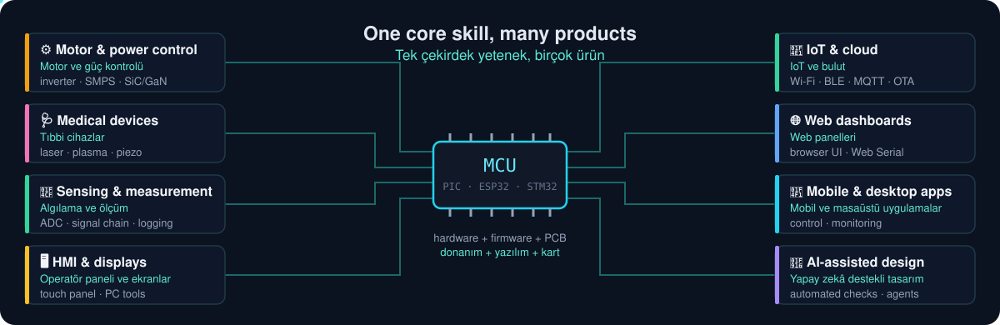
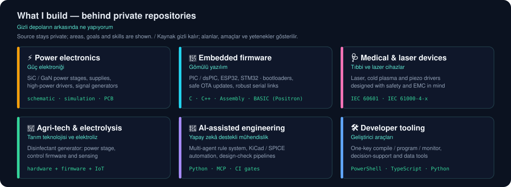
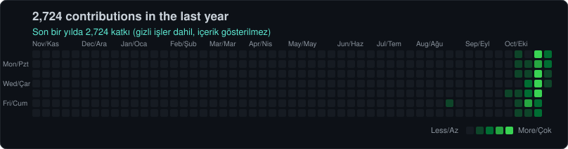
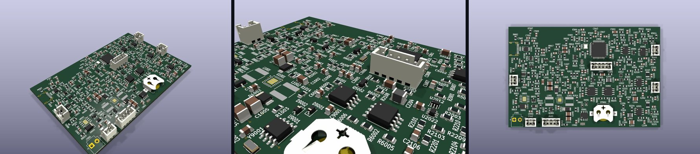

<picture>
  <source media="(max-width: 700px) and (prefers-color-scheme: light)" srcset="assets/banner_m_light.svg">
  <source media="(max-width: 700px)" srcset="assets/banner_m.svg">
  <source media="(prefers-color-scheme: light)" srcset="assets/banner_light.svg">
  
</picture>

## 🔌 One core skill, many products / Tek çekirdek, birçok ürün

<picture>
  <source media="(max-width: 700px) and (prefers-color-scheme: light)" srcset="assets/mcu_hub_m_light.svg">
  <source media="(max-width: 700px)" srcset="assets/mcu_hub_m.svg">
  <source media="(prefers-color-scheme: light)" srcset="assets/mcu_hub_light.svg">
  
</picture>

## 🗺️ What I work on / Neler yapıyorum

Most of my work lives in **private repositories**. The map shows the areas, goals and skills behind it — without exposing any source. 
Çalışmalarımın çoğu **gizli depolarda**. Harita, kaynak kodu göstermeden alanları, amaçları ve yetenekleri özetler.

<picture>
  <source media="(max-width: 700px) and (prefers-color-scheme: light)" srcset="assets/work_map_m_light.svg">
  <source media="(max-width: 700px)" srcset="assets/work_map_m.svg">
  <source media="(prefers-color-scheme: light)" srcset="assets/work_map_light.svg">
  
</picture>

| Area / Alan | Goal / Amaç | What I bring / Katkım |
|---|---|---|
| ⚡ Power electronics Güç elektroniği | Efficient, reliable power stages Verimli, güvenilir güç katları | SiC/GaN topologies, magnetics, thermal & EMC SiC/GaN topolojileri, manyetik, ısıl ve EMC tasarım |
| 🔧 Embedded firmware Gömülü yazılım | Firmware that survives the field Sahada dayanan yazılım | Hardware-first design, bootloaders, safe updates Önce donanım, bootloader, güvenli güncelleme |
| 🩺 Medical & laser Tıbbi ve lazer | Safe, certifiable devices Güvenli, belgelendirilebilir cihazlar | Laser, cold plasma, piezo drivers; IEC 60601 / 61000 Lazer, soğuk plazma, piezo sürücüler |
| 🌱 Agri-tech Tarım teknolojisi | Field-ready electrolysis systems Sahaya hazır elektroliz sistemleri | Power + control + sensing in one design Güç + kontrol + algılama tek tasarımda |
| 🤖 AI-assisted engineering Yapay zekâ destekli mühendislik | Faster, checked design cycles Daha hızlı, denetimli tasarım | Multi-agent workflows, KiCad/SPICE automation Çok ajanlı iş akışları, KiCad/SPICE otomasyonu |
| 🛠️ Tooling Araçlar | One-click developer experience Tek tıkla geliştirme | Compile / program / monitor, data tools Derle / yükle / izle, veri araçları |

---

## 👋 About / Hakkımda

<table>
<tr>
<td width="50%" valign="top">

🇬🇧 I design electronic products end to end — power stage, schematic, PCB, firmware and field tests. For over three decades my work has centred on power electronics, embedded control and medical / laser device R&D, with more than 300 original circuit designs along the way.

Today I pair that hardware background with IoT connectivity, simple web interfaces and AI-assisted design checks. Most projects are private product work; this page summarises what they are about. Open to collaboration on embedded, power and connected-device projects.

</td>
<td width="50%" valign="top">

🇹🇷 Elektronik ürünleri uçtan uca tasarlıyorum: güç katı, şema, kart (PCB), gömülü yazılım ve saha testleri. Otuz yılı aşkın süredir işimin merkezinde güç elektroniği, gömülü kontrol ve tıbbi / lazer cihaz Ar-Ge'si var; bu süreçte 300'ü aşkın özgün devre tasarladım.

Bugün bu donanım birikimini IoT bağlantısı, sade web arayüzleri ve yapay zekâ destekli tasarım kontrolleriyle birleştiriyorum. Projelerimin çoğu gizli ürün çalışmalarıdır; bu sayfa ne üzerine olduklarını özetler. Gömülü sistem, güç elektroniği ve bağlantılı cihaz projelerinde iş birliğine açığım.

</td>
</tr>
</table>

---

## 📈 Activity / Hareketler

   

<picture>
  <source media="(max-width: 700px) and (prefers-color-scheme: light)" srcset="assets/contributions_m_light.svg">
  <source media="(max-width: 700px)" srcset="assets/contributions_m.svg">
  <source media="(prefers-color-scheme: light)" srcset="assets/contributions_light.svg">
  
</picture>

<!--ACTIVITY:START-->

**Last 7 days / Son 7 gün**

| Day / Gün | Contributions / Katkı | Active repos / Aktif depo | Pushes / Gönderim | PRs opened / Açılan PR | PRs merged / Birleşen PR | New repos / Yeni depo |
|:--|:-:|:-:|:-:|:-:|:-:|:-:|
| 31.10.2026 | 5 | 1 | 0 | 3 | 2 | 0 |
| 30.10.2026 | 185 | 22 | 0 | 72 | 71 | 0 |
| 29.10.2026 | 3 | 1 | 15 | 0 | 0 | 0 |
| 28.10.2026 | 73 | 8 | 46 | 23 | 25 | 0 |
| 27.10.2026 | 28 | 5 | 7 | 0 | 0 | 0 |
| 26.10.2026 | 159 | — | — | — | — | — |
| 25.10.2026 | 164 | — | — | — | — | — |

— = older than the event window GitHub keeps / GitHub'ın olay kaydı süresinden eski

**Latest events / Son hareketler**

| Time / Zaman (TRT) | Project / Proje | Event / Olay | Detail / Ayrıntı |
|:--|:--|:--|:--|
| 31.10.2026 01:55 | 🔒 Private / Gizli | 🟢 PR opened / açıldı |  |
| 31.10.2026 01:32 | 🔒 Private / Gizli | 🟣 PR merged / birleştirildi |  |
| 31.10.2026 01:31 | 🔒 Private / Gizli | 🟢 PR opened / açıldı |  |
| 31.10.2026 01:30 | 🔒 Private / Gizli | 🟣 PR merged / birleştirildi |  |
| 31.10.2026 01:29 | 🔒 Private / Gizli | 🟢 PR opened / açıldı |  |
| 30.10.2026 22:48 | 🔒 Private / Gizli | 🟣 PR merged / birleştirildi |  |
| 30.10.2026 22:48 | 🔒 Private / Gizli | 🟢 PR opened / açıldı |  |
| 30.10.2026 22:46 | 🔒 Private / Gizli | 🟣 PR merged / birleştirildi |  |
| 30.10.2026 22:46 | 🔒 Private / Gizli | 🟢 PR opened / açıldı |  |
| 30.10.2026 21:15 | 🔒 Private / Gizli | 🟣 PR merged / birleştirildi |  |
| 30.10.2026 19:45 | 🔒 Private / Gizli | 🟢 PR opened / açıldı |  |
| 30.10.2026 17:18 | 🔒 Private / Gizli | 🟣 PR merged / birleştirildi |  |

Updated automatically / Otomatik güncellendi: 31.10.2026 02:05 TRT · private work shows counts only / gizli işlerde yalnız sayılar gösterilir

<!--ACTIVITY:END-->

---

## 🧰 Toolbox / Araç kutusu

<table>
<tr><td><b>MCUs</b> Mikrodenetleyiciler</td><td>  </td></tr>
<tr><td><b>EDA &amp; simulation</b> Tasarım ve benzetim</td><td>  </td></tr>
<tr><td><b>Languages</b> Diller</td><td>     </td></tr>
<tr><td><b>Toolchains</b> Derleme araçları</td><td>   </td></tr>
<tr><td><b>Connectivity</b> Bağlantı</td><td>   </td></tr>
</table>

---

## 🖼️ Selected work / Seçili işler

<picture>
  <source media="(max-width: 700px)" srcset="assets/gallery/strip_m.jpg">
  
</picture>

**4-layer mixed-signal board · 233 parts · MCU, power and measurement on one board** — KiCad 10 3D views: overview, close-up, top. 
**4 katmanlı karışık sinyal kartı · 233 parça · MCU, güç ve ölçüm tek kartta** — KiCad 10 3B görünümleri: genel, yakın, üst.

---

## 📌 Public projects / Açık projeler

| Project / Proje | What it does / Ne yapar |
|---|---|
| [**CNanoKit**](https://github.com/onderk/CNanoKit) | One-key compile, program and monitor for the PIC18F56Q71 Curiosity Nano with Positron8 PIC18F56Q71 Curiosity Nano için tek tuşla derleme, yükleme ve izleme (Positron8) |

---

## 🧭 How I work / Nasıl çalışırım

- **Evidence first** — every design decision traced to a datasheet, app note or standard. **Önce kanıt** — her karar bir veri sayfasına, uygulama notuna ya da standarda dayanır.
- **Hardware first** — peripherals do the work; firmware stays simple and testable. **Önce donanım** — işi çevre birimleri yapar; yazılım sade ve test edilebilir kalır.
- **Future-proof** — parameter tables, spare ports and safe update paths from day one. **Geleceğe hazır** — ilk günden parametre tabloları, yedek portlar ve güvenli güncelleme yolu.
- **Automated checks** — ERC/DRC, quality gates and reviews before anything ships. **Otomatik kontrol** — teslimden önce ERC/DRC, kalite kapıları ve gözden geçirme.
